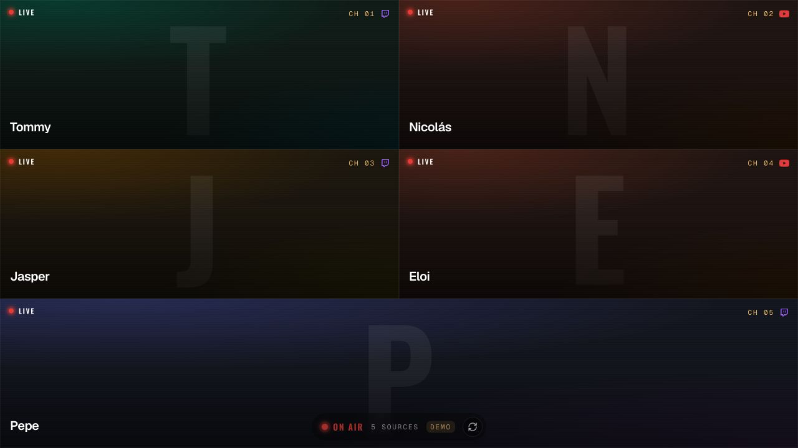
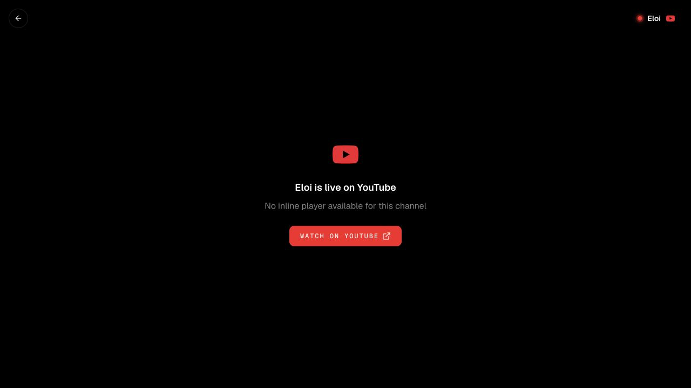
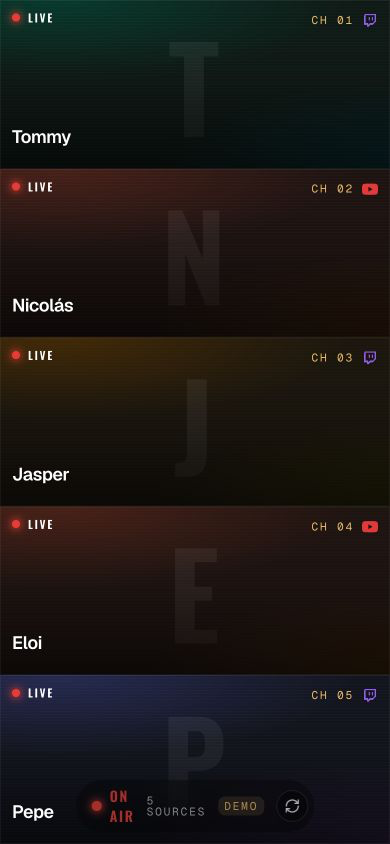

# StreamGuard site

StreamGuard Site is a companion web surface for
[StreamGuard](https://github.com/lutzseverino/minecraft-stream-guard), a
Paper/Spigot plugin that checks whether survival players are live on Twitch or
YouTube.

The site reads the plugin's live feed and turns the current streamers into a
fullscreen broadcast wall. Every live player becomes a screen; selecting a
screen opens the Twitch or YouTube embed.

## Development

Follow the [shared setup and validation guide](../docs/development/README.md)
and [contribution instructions](../CONTRIBUTING.md). From `site/`:

```sh
pnpm install --frozen-lockfile
pnpm dev
pnpm validate
```

`pnpm validate` runs formatting, lint, types, tests, architecture, documentation,
registry integrity and production build checks. `pnpm build` writes `dist/`.
See [site development](docs/development/README.md) for local tool configuration.

## Screenshots

Captured from the local development demo feed.



| Focused stream | Mobile wall |
| --- | --- |
|  |  |

## Plugin Feed

The site reads `/api/live`, served by the
[StreamGuard plugin](https://github.com/lutzseverino/minecraft-stream-guard). In local development,
`vite.config.ts` proxies that path to `http://127.0.0.1:8127`.

When the plugin is not running, development builds use a demo feed so the wall remains inspectable.
Production builds expect the real plugin feed.

## Documentation

[Documentation](docs/README.md)

## License

[GNU General Public License v3.0 only](LICENSE)
